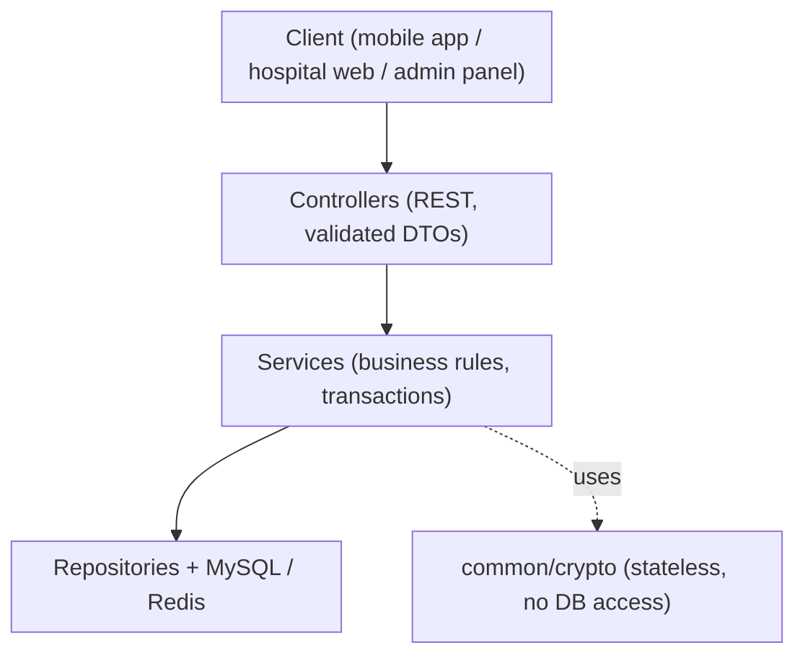
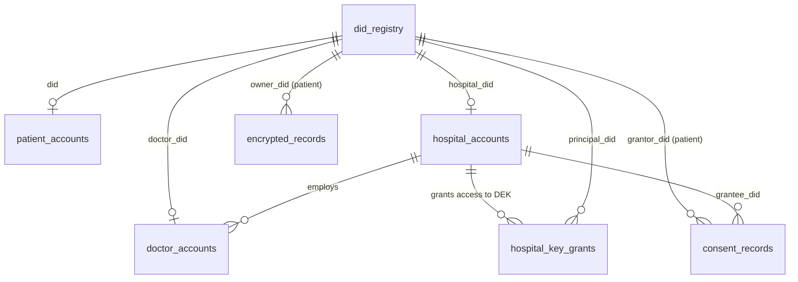
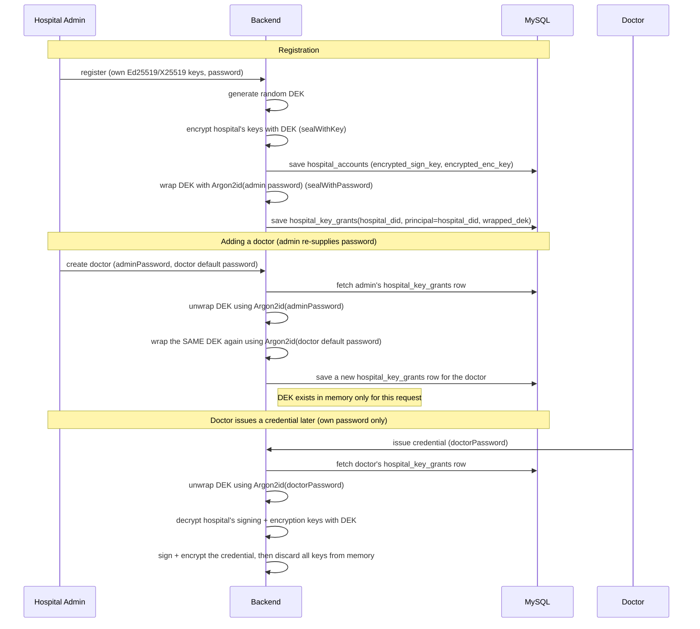

# NEHR Backend — Technical Documentation

This document explains how `nehr-backend` is built, why it's built that
way, and what's needed to run or extend it. It's written to double as
reference material for the project write-up and defense.

Companion files: [`README.md`](../README.md) (quick local setup),
[`CLAUDE.md`](../CLAUDE.md) (coding rules for this repo),
[`TECH_DEBT.md`](../TECH_DEBT.md) (every deliberate deviation from
chapters 1-3 and everything explicitly deferred — read that alongside
this document, since this document describes what *was* built and
TECH_DEBT.md describes what wasn't, and why).

---

## 1. What this module is

The NEHR Platform inverts the usual EHR ownership model: instead of a
hospital owning a patient's record and the patient requesting access, the
patient holds a cryptographic identity (a `did:nehr` Decentralized
Identifier) and hospitals issue signed Verifiable Credentials to that
identity. The server stores only ciphertext for health content — it can
decrypt a hospital's own operational keys (needed to sign/encrypt on the
hospital's behalf) but never a patient's private keys or their record
content.

This backend covers four bounded contexts, built as one Spring Boot
deployable rather than three separate services (see TECH_DEBT.md for why):

| Context | Package | Responsibility |
|---|---|---|
| Identity | `identity` | The `did:nehr` method — create (via registration), resolve, deactivate |
| Accounts & Auth | `account.*`, `auth` | Registration and login for patients, hospitals, doctors, platform admins; DID challenge-response; JWT issuance |
| Credentials & Consent | `consent`, `credentials` | Consent request/accept/revoke; Verifiable Credential issuance, storage, and verification |
| Audit | `audit` | Hash-chained log of who did what, for platform admin and hospital admin review |

Everything in `common/` (`crypto`, `security`, `web`, `config`) is shared
infrastructure the four contexts build on, not a context itself.

---

## 2. Architecture

### 2.1 Package layout

```
ng.nehr.backend
├── common
│   ├── crypto     Ed25519/X25519/BLAKE3/Argon2id/XChaCha20-Poly1305, envelope encryption, encodings
│   ├── security   JWT issuance/parsing, blacklist, rate limiting, Spring Security wiring
│   ├── web        Exception hierarchy, global handler, OpenAPI/Swagger config
│   └── config     nehr.* configuration properties
├── identity       DID Registry (the did:nehr method)
├── account
│   ├── patient        Self-custody & managed-custody patient accounts
│   ├── hospital       Hospital accounts, institutional key custody, key-grant envelope encryption
│   ├── doctor         Doctor accounts, provisioning by a hospital admin
│   └── platformadmin  Seeded platform admin, hospital approval
├── auth           Cross-actor DID challenge-response, token refresh, logout
├── consent        Consent request/accept/revoke
├── credentials    Verifiable Credential build/sign/encrypt/store/verify
└── audit          Hash-chained audit log + read endpoints
```

Each context package owns its entity, repository, service(s), controller(s),
and a `dto/` subpackage together (package-by-feature). A class only moves
into `common/` when more than one context genuinely needs it.

### 2.2 Request flow: the four layers



Controllers never touch a repository directly; services never touch
`HttpServletRequest`/response objects. Crypto helpers in `common/crypto`
are pure (no Spring Data, no side effects beyond `SecureRandom`), which is
why they could be unit-tested against published test vectors without a
Spring context (see §9).

### 2.3 Actor model

Four actor types, one JWT shape, different issuance/authentication paths:

| Actor | Has a DID? | Login mechanism | Notes |
|---|---|---|---|
| Patient (self-custody) | Yes | DID challenge-response (`/auth/challenge` + `/auth/verify`) | No password at all; proves control of the private key directly |
| Patient (managed-custody) | Yes | Email + password | Server stores an *opaque* encrypted private-key blob it never decrypts itself |
| Hospital admin | Yes (the hospital's own DID) | Email + password | Server *does* decrypt the hospital's keys — needed to sign VCs server-side |
| Doctor | Yes (own DID, `entity_type=PROVIDER`) | Email + password | Own personal keypair; issues credentials using the *hospital's* key via a key grant |
| Platform admin | No | Email + password | Outside the DID/VC trust model entirely; one row, seeded on boot |

---

## 3. Data model

### 3.1 Tables and what they're for

| Table | Purpose |
|---|---|
| `did_registry` | Every DID's public key material and DID Document (JSON). The one source of truth for public keys — never duplicated elsewhere. |
| `patient_accounts` | Custody type + (managed only) email/password hash/encrypted private-key blobs |
| `hospital_accounts` | Hospital identity, login credentials, its Ed25519/X25519 keys encrypted under a DEK |
| `hospital_key_grants` | Per-principal wrapped copies of a hospital's DEK (see §4.6) |
| `doctor_accounts` | Doctor identity, login credentials, own encrypted keys, `token_version` for instant mass-invalidation |
| `platform_admins` | The seeded admin account(s) |
| `consent_records` | Patient consent: who requested it, what scope, signed by the patient to grant |
| `encrypted_records` | Generic ciphertext store keyed by owner DID — today holds issued VCs |
| `audit_trail` | Hash-chained log entries |
| `revoked_credentials` | Exists in the schema, **not yet wired to any code** (see TECH_DEBT.md) |

Full column-level detail is in the Flyway migration:
[`V1__baseline_schema.sql`](../src/main/resources/db/migration/V1__baseline_schema.sql)
— that file is the actual schema of record, this document doesn't restate
every column.

### 3.2 Entity relationships



Note what's *not* duplicated: public keys live only in `did_registry`.
`patient_accounts`, `hospital_accounts`, and `doctor_accounts` hold
account metadata and **private**-key ciphertext only — a deliberate
normalization beyond what chapter 3.5.2 originally specified (see
TECH_DEBT.md).

---

## 4. Cryptography and key-generation business logic

This is the part most worth understanding carefully, since correctness
here is what the whole sovereignty model rests on. Every primitive below
was verified against a published test vector or an independent
cross-check before being trusted — see §9.

### 4.1 Library choice

Bouncy Castle's **lightweight API** (`org.bouncycastle.crypto.*`) is used
directly for every raw operation — not the JDK's native Ed25519/X25519
support (which only exposes ASN.1-wrapped key encodings, unnecessary
ceremony for a method that only ever stores/transmits raw 32-byte keys),
and not BC's JCA/JCE provider layer (avoids registering a `Provider` and
looking up algorithms by string name). One library, one calling
convention, everywhere: `common/crypto/KeyPairService`,
`Blake3Hasher`, `Argon2idKdf`, `XChaCha20Poly1305Cipher`.

### 4.2 Ed25519 — signing

Used for: DID authentication proofs, consent signatures, Verifiable
Credential proofs.

- Generation: `Ed25519PrivateKeyParameters(SecureRandom)` → `generatePublicKey()`. Raw 32-byte keys both ways.
- Sign/verify: `Ed25519Signer`, initialized for signing or verification.
- **Who generates the keypair**: the *client* — patient app, hospital web
  app — for patients and hospitals. Doctors are the one exception: their
  keypair is generated **server-side** at creation time (a deliberate
  simplification agreed in conversation — see TECH_DEBT.md — since there's
  no forced first-login flow yet for a doctor's own client to generate
  keys during).

### 4.3 X25519 — key agreement

Used for: encrypting a Verifiable Credential for its patient recipient.

- Generation/encoding: same pattern as Ed25519.
- Agreement: `X25519Agreement` — `agreeX25519(privateKey, publicKey)` in
  `KeyPairService`, verified against the official RFC 7748 test vector in
  `KeyPairServiceTest`.
- **Construction used for VC encryption** (`CredentialIssuanceService`):
  `sharedSecret = X25519(hospitalX25519PrivateKey, patientX25519PublicKey)`,
  then `symmetricKey = BLAKE3-256(sharedSecret)` as a simple KDF, then
  XChaCha20-Poly1305 with a fresh random nonce. The patient's own client
  reproduces the identical shared secret via
  `X25519(patientPrivateKey, hospitalPublicKey)` (Diffie-Hellman is
  commutative) to decrypt — the server is never given the patient's
  private key and never decrypts the record itself.
  This reuses the hospital's **long-term** X25519 key rather than an
  ephemeral per-message keypair — simpler, no extra storage, but not
  forward-secret (flagged in TECH_DEBT.md).

### 4.4 BLAKE3 — hashing

Used for: deriving a DID from a public key, the audit hash chain, and the
content-hash embedded in a VC's proof.

- `Blake3Digest(256)` from Bouncy Castle, 32-byte output.
- Verified against the **official BLAKE3 test vectors**
  (`BLAKE3-team/BLAKE3/test_vectors`) for empty, 1-byte, and 64-byte
  inputs in `Blake3HasherTest`.
- **DID derivation** (`identity/DidIdentifierFactory`):
  `did:nehr:` + base32(lowercase, unpadded) of `BLAKE3-256(ed25519PublicKey)`.

### 4.5 Argon2id — password-based key derivation

Used for: deriving a symmetric key from a password, to encrypt/decrypt a
private key or a wrapped DEK. **Never** used for login authentication
itself — that's a separate bcrypt hash (see §5.1). Two different KDFs from
the same password, for two different purposes.

- Parameters (`common/crypto/Argon2idKdf`): Argon2id, version 0x13,
  3 iterations, 64 MB memory, 1 lane — tuned for a single request on a
  commodity server, not a mobile device.
- 16-byte random salt per derivation, stored alongside the ciphertext it
  protects (see §4.7's sealed-box format).

### 4.6 XChaCha20-Poly1305 — authenticated encryption

Used for: every symmetric encryption in the system — private-key
ciphertext, wrapped DEKs, and VC content.

Chosen (per ch.3.6.2) over AES-GCM: faster than AES without hardware
acceleration, and its 192-bit nonce removes any practical nonce-reuse risk
across the system's many independent encryptions (a 96-bit nonce, as in
plain ChaCha20-Poly1305 or AES-GCM, would need careful counter management
at this volume; XChaCha's nonce can just be generated randomly every time).

**Bouncy Castle has no native XChaCha20 implementation** — only standard
96-bit-nonce ChaCha20-Poly1305 (RFC 8439). `common/crypto/HChaCha20` is a
from-scratch implementation of the missing piece: the HChaCha20 subkey
derivation function from draft-irtf-cfrg-xchacha (the ChaCha20 block
permutation run on the first 16 bytes of the 24-byte nonce, without the
final state-addition step). `XChaCha20Poly1305Cipher` then feeds that
32-byte subkey and a 12-byte nonce (4 zero bytes + the remaining 8 nonce
bytes) into Bouncy Castle's standard `ChaCha20Poly1305` mode. Verified
against **libsodium-generated XChaCha20-Poly1305 test vectors**
(`webmaster128/xchacha20poly1305-testvectors`) covering empty and 63-byte
plaintexts with and without AAD, in `XChaCha20Poly1305CipherTest`.

### 4.7 Envelope encryption — the two sealed-box formats

`common/crypto/EnvelopeCipher` builds two ciphertext formats on top of
XChaCha20-Poly1305:

- **Key-based** (`sealWithKey`/`openWithKey`): `nonce(24) || ciphertext+tag`.
  Used for a hospital's own Ed25519/X25519 private keys, which are
  protected by a randomly-generated DEK rather than a human's password.
- **Password-based** (`sealWithPassword`/`openWithPassword`):
  `salt(16) || nonce(24) || ciphertext+tag`. Used for a doctor's personal
  key material, and for wrapping a copy of a hospital's DEK per
  grant-holder.

### 4.8 The hospital key-grant scheme

This is the piece worth walking through carefully, since it's the least
obvious part of the design. The problem it solves: a hospital's
institutional signing key needs to be usable by the **server**, on behalf
of **any authorized staff member** (the admin, or any doctor), using only
that staff member's own password — without ever caching a decrypted key
across requests, and without needing a doctor to somehow know the admin's
password.



Removing a doctor's access is just deleting (or marking revoked) their
`hospital_key_grants` row — the hospital's actual signing key is never
rotated or exposed to re-wrap for everyone else.

`account.hospital.HospitalKeyUnwrapService` is the one place this
unwrap-DEK-then-decrypt-a-specific-key logic lives; both
`DoctorProvisioningService` (adding a doctor) and
`CredentialIssuanceService` (issuing a VC) call into it rather than
duplicating the logic.

### 4.9 Verifiable Credential proof — signing and verifying

`credentials/VerifiableCredentialCodec` builds and verifies the VC shape.
The proof signs a **deterministic digest of the credential's own core
scalar fields**:

```
digest = issuerDid | subjectDid | resourceType | issuanceDateEpochMillis | contentHash
signature = Ed25519(hospitalSigningKey, digest)
```

where `contentHash = base64(BLAKE3-256(canonical JSON bytes of content))`.
This is a deliberate simplification of full W3C JSON-LD canonicalization
(URDNA2015 RDF dataset normalization) — same tamper-evidence guarantee
(changing `content` changes `contentHash`, which is itself inside the
signed digest, so any tampering anywhere breaks the signature check), far
simpler to implement and defend for a prototype. Verification
independently recomputes `contentHash` from the received `content` and
rejects if it doesn't match the claimed one, *before* even checking the
signature — this catches "the metadata is untouched but the content was
swapped" tampering that checking the signature alone wouldn't.

### 4.10 Consent signing

Same pattern as the VC proof, one level simpler: `consent/ConsentRecord`
exposes `canonicalSigningPayload()` —
`consentId|grantorDid|granteeDid|scope|purpose|validFrom|validUntil` —
which the patient's client signs with their Ed25519 key to grant a
request. The server only ever verifies this signature
(`ConsentService.accept`); it never signs on the patient's behalf,
regardless of custody type.

---

## 5. Authentication and authorization

### 5.1 Two KDFs, two purposes — don't confuse them

Every managed-custody actor (patient, hospital admin, doctor) has a
password used for **two independent things**:

1. **Login verification** — bcrypt hash, stored as `password_hash`.
   Checked by `PasswordEncoder.matches()` at login. Nothing else uses it.
2. **Data-encryption key derivation** — Argon2id, salted independently,
   never stored as a hash anywhere (the salt lives inside whatever
   ciphertext blob it protects, per §4.7). Used to encrypt/decrypt
   private keys or wrapped DEKs.

The same plaintext password drives both, through two different
algorithms with two different salts, for two different purposes. This
matters because it means compromising the bcrypt hash (e.g. a leaked
`password_hash` column) does not, by itself, expose any encrypted key
material — an attacker would need the actual password.

### 5.2 JWT

`common/security/JwtService` issues and parses tokens (jjwt 0.13.0,
HMAC-SHA signing). Claims: `sub` (the DID or platform-admin id),
`actor_type`, `hospital_did` (doctor/hospital admin only), `role` and
`department` (doctor only), `token_version` (doctor only), plus standard
`jti`/`iat`/`exp`. Access tokens: 30 minutes. Refresh tokens: 7 days,
rotated (old one blacklisted) on every use.

`common/security/TokenBlacklistService` stores blacklisted `jti`s in
Redis with a TTL equal to the token's remaining lifetime — cheap, and
self-cleaning.

`common/security/JwtAuthenticationFilter` is the only place a bearer
token is read from the `Authorization` header; it populates Spring
Security's context with an `ActorPrincipal` (a plain record, not a
`UserDetails` — this system's authorization model doesn't fit Spring
Security's default abstractions well enough to fight them). Refresh
tokens are **never** accepted from this header — `/auth/refresh` and
`/auth/logout` take them in the request body instead, keeping the header
path exclusively for access tokens.

### 5.3 Authorization matrix

Enforced in `common/security/SecurityConfig` via `requestMatchers`:

| Path prefix | Requires |
|---|---|
| `/api/v1/auth/**`, `/api/v1/dids/**`, `/api/v1/credentials/verify`, Swagger/OpenAPI paths | Public |
| `/api/v1/hospitals/**` | `ROLE_HOSPITAL_ADMIN` |
| `/api/v1/doctors/**` | `ROLE_DOCTOR` |
| `/api/v1/patients/**` | `ROLE_PATIENT` |
| `/api/v1/platform-admin/**` | `ROLE_PLATFORM_ADMIN` |
| anything else | any authenticated actor |

### 5.4 Rate limiting

`common/security/RateLimiterService` — a bare Redis fixed-window counter
(increment + 60-second expiry on first increment), applied to
`/auth/challenge` and `/auth/verify` only. Not a general API-wide policy
(see TECH_DEBT.md).

---

## 6. API surface

Full request/response schemas are in Swagger, not restated here — this is
a map of what exists and where, grouped exactly as Swagger groups them
(`common/web/OpenApiConfig`).

### Auth group
- `POST /api/v1/auth/patients/register/self-custody`, `/register/managed-custody`, `/login`
- `POST /api/v1/auth/hospitals/register`, `/login`
- `POST /api/v1/auth/doctors/login`
- `POST /api/v1/auth/platform-admins/login`
- `POST /api/v1/auth/challenge`, `/verify`, `/refresh`, `/logout`
- `POST /api/v1/hospitals/me/doctors`, `GET /api/v1/hospitals/me/doctors` (admin-only doctor management)
- `GET /api/v1/platform-admin/hospitals`, `POST /{hospitalDid}/approve`
- `GET /api/v1/platform-admin/audit-trail`, `GET /api/v1/hospitals/me/audit-trail`

### DID Registry group
- `GET /api/v1/dids/{did}` — public resolution, returns a DID Resolution Result (document + metadata)

### Credentials group
- `POST /api/v1/doctors/me/consents`, `GET /api/v1/doctors/me/consents`
- `GET /api/v1/patients/me/consents`, `POST /{consentId}/accept`, `POST /{consentId}/revoke`
- `POST /api/v1/doctors/me/patients/{patientDid}/credentials` — issue a VC
- `GET /api/v1/patients/me/records`, `GET /{recordId}` — patient's own ciphertext, for client-side decryption
- `POST /api/v1/credentials/verify` — public, resolves the issuer DID and checks the signature (FR-06)

---

## 7. Redis usage

Three independent uses, all via `StringRedisTemplate`, all with a TTL so
nothing accumulates indefinitely:

| Key prefix | Written by | TTL | Purpose |
|---|---|---|---|
| `auth:challenge:<did>` | `auth/ChallengeService` | `nehr.challenge.ttl-seconds` (default 300s) | One-time DID challenge nonce; deleted on first use regardless of outcome |
| `jwt:blacklist:<jti>` | `common/security/TokenBlacklistService` | remaining token lifetime | Logged-out or rotated-away tokens |
| `ratelimit:<bucket>` | `common/security/RateLimiterService` | 60s | Fixed-window request counters |

Local connection: `spring.data.redis.host`/`port` in
`application-local.yml`, defaulting to `localhost:6379`.

---

## 8. MySQL

- **Why MySQL, not PostgreSQL**: chapter 3.4 specifies PostgreSQL with
  JSONB; MySQL 8 was chosen instead for local development convenience —
  easy to install and inspect with a GUI on the development machine. See
  TECH_DEBT.md.
- **JSON columns**: `did_document`, `scope`, `details` use MySQL's native
  `JSON` type via Hibernate's `@JdbcTypeCode(SqlTypes.JSON)` — no extra
  library needed, Jackson (already on the classpath) handles
  serialization.
- **Migrations**: Flyway, one baseline migration
  (`V1__baseline_schema.sql`) containing every table from ch.3.5 plus the
  two additions this module needed (`hospital_key_grants`,
  `doctor_accounts.full_name`/`encrypted_priv_*`). `ddl-auto: validate` —
  Hibernate checks the schema matches the entities at boot but never
  changes it; every schema change is a new migration file, reviewed like
  any other change (see CLAUDE.md).
- **Local connection**: see [`README.md`](../README.md) for the exact
  `CREATE DATABASE`/`CREATE USER` commands and the env vars
  (`DB_HOST`, `DB_PORT`, `DB_NAME`, `DB_USERNAME`, `DB_PASSWORD`) that
  override the defaults in `application-local.yml`.

---

## 9. Testing strategy

Crypto correctness is the highest-risk part of this codebase, so it's
tested against **external, independently-sourced references**, not just
internal round-trip consistency:

| Component | Verified against |
|---|---|
| BLAKE3 | Official BLAKE3 test vectors (empty, 1-byte, 64-byte inputs) |
| XChaCha20-Poly1305 (incl. hand-written HChaCha20) | libsodium-generated XChaCha20-Poly1305 test vectors |
| X25519 agreement | RFC 7748 §6.1 published test vector |
| Base58 | A well-known reference string ("Hello World" → `JxF12TrwUP45BMd`) plus an independently-written Python reference implementation |
| Ed25519, Argon2id, envelope encryption, VC codec | Round-trip + tamper-detection tests (sign/verify, seal/open, wrong-key/wrong-password failure paths, content/issuer tampering) |

Run everything: `mvn test`. 49 tests as of this module's completion, all
passing, none skipped.

This matters beyond "the code compiles": two of these verifications
(BLAKE3, X25519) caught a **transcription error on the first attempt** —
a single hex character copied wrong from a fetched reference — which
would have silently produced a working-but-non-standard implementation
(internally consistent, but not interoperable with any other BLAKE3 or
X25519 implementation) had it not been caught by comparing against the
official vector.

---

## 10. Deployment readiness

**What would need to change before this runs anywhere but a laptop:**

- `nehr.jwt.secret` — currently defaults to a hardcoded dev value in
  `application-local.yml`; `JwtService` fails fast if it's blank, but
  nothing stops a real deployment from reusing the dev default. Needs a
  real secret from actual secret management (env var / vault), not a
  committed file.
- `nehr.platform-admin.default-password` — same issue; the seeded admin's
  password must be changed (or the seeder disabled) before any real
  deployment. `PlatformAdminSeeder` logs a warning on every boot where it
  seeds, precisely so this isn't missed.
- **TLS** — ch.3.6.2 specifies TLS 1.3 for all transport; nothing in this
  module handles that itself (that's the responsibility of whatever sits
  in front of it — a reverse proxy, load balancer, or platform TLS
  termination — not application code).
- **Password recovery** — genuinely unimplemented, not just deferred
  polish (see TECH_DEBT.md). A real deployment cannot ship without an
  answer here, even if that answer is "out of scope for this prototype,
  documented as a known limitation."
- **Doctor token revocation latency** — up to one access-token TTL
  (30 min) after a suspension before it takes effect on already-issued
  tokens, since `token_version` is only re-checked at login/refresh, not
  per-request (see TECH_DEBT.md).
- **Audit trail is not a compliance-grade log yet** — no failure-event
  logging, no chain-integrity verification endpoint (something that
  recomputes every hash and confirms the chain hasn't been tampered
  with), no retention policy.
- **Rate limiting** is minimal (login/challenge endpoints only) — no
  general abuse protection, no WAF-equivalent.
- **Observability** — no metrics, tracing, or structured logging beyond
  Spring Boot's defaults. Nothing here today would page anyone if the
  audit chain broke or Redis went away mid-request.
- **HAPI FHIR validation** — record `content` is a lightweight
  FHIR-*shaped* JSON object today, not validated against real FHIR R4
  StructureDefinitions (see TECH_DEBT.md §"Record content").

**What's already in reasonable shape for a prototype/demo deployment:**

- Schema-managed database changes (Flyway, `ddl-auto: validate` — no
  drift between code and schema is possible without an explicit
  migration).
- Every secret-touching operation (login, key unwrap, credential signing)
  fails closed (wrong password → 401/403, not a silent fallback).
- Crypto primitives are verified against external references, not just
  "it compiled and the round-trip test passed."
- Stateless JWT auth means horizontal scaling of the application tier
  itself is straightforward (Redis and MySQL are the only shared state).

---

## 11. Where to look next

- Adding the credentials/consent module's remaining piece,
  `revoked_credentials` — see TECH_DEBT.md for the exact gap.
- Wiring per-request doctor `token_version` enforcement once more
  doctor-authenticated endpoints exist.
- Password recovery design for managed-custody patients and hospital
  admins — flagged repeatedly in TECH_DEBT.md as a real design gap, not
  a nice-to-have.
